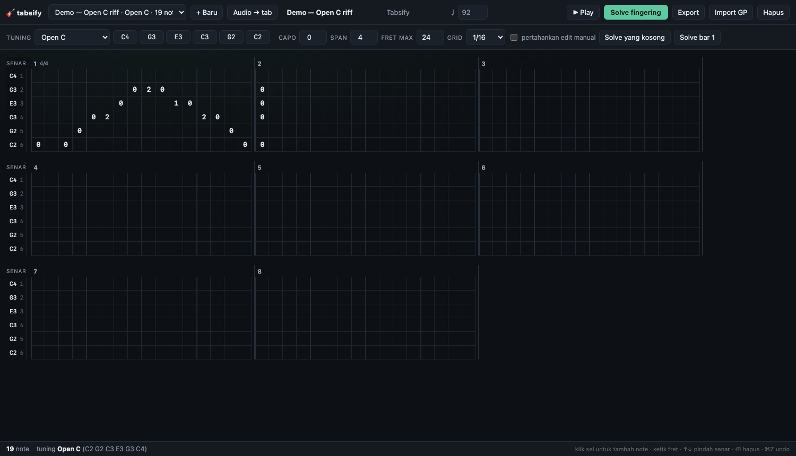
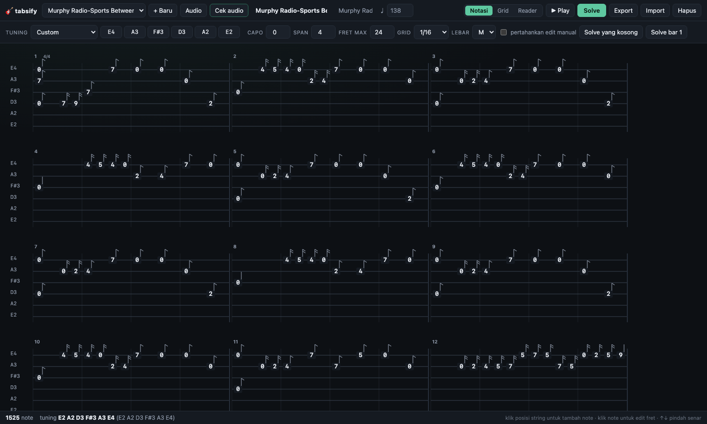
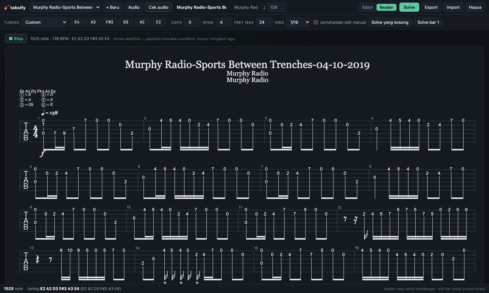

# tabsify

Workbench tablature gitar lokal: **import draft / transkripsi audio → re-fret otomatis untuk tuning custom → perbaiki per bar → export**.

Dibuat untuk alur kerja "AI generator kasih draft, saya yang benerin". Fokus utamanya bukan menggantikan model
transkripsi (itu roadmap), tapi menyelesaikan bagian yang paling bikin frustrasi: **penempatan senar/fret yang
benar untuk tuning non-standar, dan editor yang enak dipakai buat koreksi cepat.**



Tiga mode kerja: **Notasi** (editor tab berbentuk notasi), **Grid** (sel untuk input cepat), dan **Reader**
(notasi alphaTab dengan playback):





## Jawaban singkat soal hardware

Jalan nyaman di **MacBook Pro M1 Pro 16GB**. Yang dijalankan:

| Proses | Beban | Catatan |
| --- | --- | --- |
| API (Bun + SQLite) | ~50 MB | instan |
| Fret solver | <10 ms untuk ratusan note | murni TypeScript, jalan di browser juga |
| Web editor | ~250 KB JS | tanpa framework berat |
| Import/export Guitar Pro | <1 detik/lagu | alphaTab di sisi server |
| Transkripsi audio (pyin) | ~30–60 detik / lagu 4 menit | Python venv, CPU |
| Demucs stem gitar | ~1–3 menit / lagu 4 menit | torch 2.14, CPU |
| CREPE (opsional) | ~30x lebih lambat dari pyin | tidak dipakai default |

Semua data lokal: `apps/api/data/tabsify.db` (SQLite) + file `.gp` di disk. Tidak ada API key, tidak ada cloud.
Catatan: **cek ruang disk** sebelum menambah pipeline audio (Demucs + model AMT butuh ~3–5 GB).

## Quickstart

Prasyarat: [Bun](https://bun.sh) 1.1+ (sudah ada di mesin ini).

```bash
bun install
bun run dev          # api :3001 + web :5173 (vite proxy /api)
```

Buka <http://localhost:5173>. Demo song "Open C riff" otomatis dibuat saat pertama kali jalan.

Pipeline audio (opsional, sekali saja):

```bash
cd services/ml
/opt/homebrew/bin/python3.12 -m venv .venv      # PyTorch belum support 3.14
.venv/bin/pip install -r requirements.txt
.venv/bin/python tests/test_synthetic.py        # sanity check
```

Aset reader (font Bravura, soundfont, worker alphaTab) disalin otomatis dari `node_modules`
oleh `apps/web/scripts/copy-alpha-assets.mjs` saat `dev`/`build`, jadi tidak perlu di-commit.

Tanpa venv ini tombol *Audio → tab* tampil nonaktif, sisa aplikasi tetap jalan.
Demucs + torchcrepe sudah terpasang di mesin ini (`separate: true`), tapi keduanya
opsional — pipeline otomatis memakai full mix kalau stem gitar terlalu pelan.
Panduan lengkap pipeline ada di [`services/ml/README.md`](services/ml/README.md).

Mode produksi (satu port, tanpa Vite):

```bash
bun run build        # build web ke apps/web/dist
bun run start        # api + serve dist di http://localhost:3001
```

Test & typecheck:

```bash
bun test
bun run typecheck
```

## Alur kerja yang didukung

0. **Draft dari audio** — klik *Audio → tab*, pilih mp3/wav, dan **set tuning di panel**
   (preset atau ketik bebas, mis. `D2 G2 C3 F3 A3 D4`). Pipeline menebak nada, menghitung
   tempo, dan opsional menambahkan fifth untuk power chord. Kalau tuning di panel beda
   dengan tab yang terbuka, hasil transkripsi memakai tuning panel.
   Pilih juga **sumber audio**: `Otomatis` (6-stem gitar → 4-stem "other" → mix),
   `Stem gitar`, `Stem other` (vokal dibuang), atau `Full mix`. Setelah selesai, tombol
   **▶ stem** memutar file yang benar-benar dianalisis — cara tercepat memastikan
   separation tidak mengambil vokal/bass.
1. **Draft dari AI/komunitas** — buka Songsterr atau Ultimate Guitar, download `.gp`.
2. **Import** ke tabsify (tombol *Import GP*). Semua note, tuning, dan capo terbaca.
3. **Ubah tuning** di bar tuning: pilih preset atau ketik bebas per senar (`D2`, `C#3`, `Bb1`, dst).
   Semua pitch dipertahankan, fingering dihitung ulang otomatis untuk tuning baru.
4. **Solve fingering** — global, atau hanya bar yang aktif (*Solve bar N*) supaya edit manual di bar lain aman.
5. **Cek audio** (opsional) — tombol *Cek audio* membandingkan tab dengan rekaman. Pipeline men-track pitch
   audio, menyelaraskan offset secara otomatis, lalu memberi skor 0–100% per bar. Bar yang pitch-nya tidak
   cocok ditandai merah di grid — jadi koreksi manual langsung terarah, bukan menebak.
6. **Perbaiki bar** — dua editor: **Notasi** (garis senar, fret, stem/flag, nomor bar, tuning — klik posisi
   string untuk menambah note, klik note untuk edit fret) dan **Grid** (sel per 1/16 untuk input cepat).
   `↑`/`↓` pindah senar tanpa mengubah pitch, `⌫` hapus, `⌘Z` undo. Note yang tidak bisa dijangkau di-tuning
   tersebut ditandai merah + alasannya di status bar. Ada zoom (S/M/L), tooltip nama nada, dan tombol
   **↦ bar bermasalah** untuk melompat ke bar hasil verifikasi berikutnya.
7. **Baca / mainkan** — tombol **Reader** menampilkan notasi tab sesungguhnya (stems, beams, istirahat, tuning,
   tempo) lewat alphaTab, dengan playback soundfont dan kursor yang mengikuti lagu.
6. **Cek suara** — tombol *Play* (sintesis WebAudio, tanpa soundfont), playhead mengikuti bar.
9. **Export** — `.gp` (Guitar Pro 7), `.mid`, `.atex` (alphaTex), `.json`.

Autosave berjalan ~0.9 detik setelah perubahan terakhir; setiap `PUT` menyimpan revision sebelumnya
(`GET /api/songs/:id/revisions`), jadi tidak ada kerja yang hilang.

### Akurasi & performa pipeline audio

Diukur di M1 Pro 16 GB dengan audio sintetis (bukan rekaman asli):

| Skenario | Hasil |
| --- | --- |
| 8 nada riff, pyin | pitch 8/8 benar, tick rapi, 2.5 detik |
| 8 nada riff, CREPE | pitch 8/8 benar, tapi **46 detik** untuk klip 4 detik |
| Mix gitar+bass+drum, demucs | separation jalan; stem gitar sintetis terlalu pelan → fallback ke mix, pitch tetap 4/4 benar |

Kesimpulan: **pyin adalah default**. CREPE hanya untuk eksperimen offline lewat CLI.
Stem gitar dianggap tidak layak kalau levelnya < 12% dari mix, lalu pipeline kembali
ke full mix dan menulis peringatan di diagnostics.

Perbaikan yang membuat rekaman asli (bukan sintetis) jauh lebih baik:

1. **Voicing mask** — `librosa.pyin` (1.0) bisa melaporkan probabilitas ~0.01 untuk sinyal
   distorsi walaupun pitch-nya valid. Threshold absolut dulu membuang *semua* nada;
   sekarang gate memakai `isfinite(f0)` dan probabilitas dinormalisasi.
2. **Koreksi oktaf** — dua jalur: energi di `f0/2` ≥ 50% energi `f0`, atau **bukti harmonik
   ganjil** (energi di `1.5×f0` / `2.5×f0`). Gitar sering kehilangan fundamentalnya, jadi
   pyin terkunci ke harmonik kedua (satu oktaf terlalu tinggi) — aturan kedua ini yang
   menyelamatkan riff D standard.
3. **Filter onset & boundary** — onset di ekor decay dibuang (slope energi), onset tidak
   lagi di-backtrack (bias ~50 ms yang membuat kuantisasi bergeser), dan batas nada dari
   track pitch dihaluskan median filter supaya getaran 1 semitone tidak memecah nada.
4. **Note berulang tetap terpisah** — nada sama yang dipetik ulang tidak lagi digabung.
5. **Tempo refinement dibatasi ±8%** dari estimasi beat tracker; tanpa batas ini tempo bisa
   melompat ke 1.5×/3× yang residual grid-nya sama kecil.

Power chord (root+fifth) sekarang **opt-in** — untuk riff bersih seperti *Come as You Are*
deteksi fifth justru menambah nada palsu. Nyalakan hanya untuk materi distorsi.

## Struktur repo

```
tabsify/
├── packages/tab-engine/          # inti, tanpa DOM
│   ├── src/types.ts              # model Tab/NoteEvent/Tuning, preset tuning
│   ├── src/pitch.ts              # MIDI ↔ nama nada, parsing tuning
│   ├── src/timeline.ts           # grid bar dari time signature
│   ├── src/solver.ts             # 🔥 fret solver (DP beam search)
│   ├── src/alphatex.ts           # exporter alphaTex (bar, tuplet, tie)
│   ├── src/midi.ts              # exporter MIDI (SMF format 1)
│   └── src/alphatab.ts           # adapter GP import/export (alphaTab)
├── apps/api/                     # Hono + bun:sqlite
│   ├── src/db.ts                 # songs + revisions (snapshot JSON)
│   ├── src/seed.ts               # demo song
│   └── src/index.ts              # REST + static web
├── services/ml/                  # Python 3.12 sidecar (audio → tab / verifikasi)
│   ├── tabsify_ml/transcribe.py  # pitch tracking + segmentasi + kuantisasi
│   ├── tabsify_ml/verify.py      # skor kecocokan tab vs audio per bar
│   ├── tabsify_ml/separate.py    # demucs (opsional)
│   └── tabsify_ml/pipeline.py    # CLI, output JSON tab
└── apps/web/                     # React 19 + Vite
    ├── src/App.tsx               # state, autosave, shortcut, solve, verify
    ├── src/TabGrid.tsx           # grid editor (bar × senar, zoom, tooltip)
    ├── src/TabNotation.tsx       # editor notasi SVG (garis senar, stem, klik-untuk-edit)
    ├── src/NoteField.tsx         # input fret inline (dipakai grid & notasi)
    ├── src/TabReader.tsx         # reader alphaTab: notasi + playback
    ├── src/TuningBar.tsx         # preset + input per senar + opsi solver
    └── src/usePlayback.ts        # WebAudio pluck synth + playhead
```

### Notasi vs Reader

| | Notasi (editor) | Reader (alphaTab) |
| --- | --- | --- |
| Tujuan | mengedit | membaca & memutar |
| Renderer | SVG sendiri, mengikuti model data kita | alphaTab (beams, istirahat, layout profesional) |
| Klik note | pilih + edit fret inline | hanya pindah posisi playback |
| Playback | synth WebAudio sederhana | soundfont + kursor |

alphaTab dipakai untuk *rendering/playback* karena tidak punya API editing (tidak ada caret, insert note via
mouse, atau hit-test untuk edit). Editor notasi kita menggambar sendiri supaya editing tetap penuh kontrol.

## Model data

Semua waktu dalam **tick, 960 per quarter note** (sama seperti Guitar Pro).

```ts
type NoteEvent = {
  id: string;
  tick: number;        // absolut dari awal lagu
  duration: number;    // tick
  midi: number;        // sumber kebenaran pitch
  string?: number;     // index 0 = senar terendah (6th string), N-1 = senar tertinggi
  fret?: number;       // relatif terhadap capo
};
```

`string` disimpan 0-based dari senar terendah. Saat export ke alphaTex, angka senar dibalik
(`stringCount - index`) karena alphaTex menghitung senar 1 = tertinggi. Konversi yang sama dipakai saat import.

### Tuning ekstrem

Tuning bukan "offset dari standar", tapi **array pitch per senar**, sehingga tuning acak, drop, open, 7/8 senar,
bahkan non-monotonik semuanya valid. Contoh yang dipakai di test: `[34, 41, 46, 51, 56, 61]`.

## Cara kerja fret solver (`packages/tab-engine/src/solver.ts`)

1. **Grouping** — note dengan tick sama (opsional toleransi `chordToleranceTicks`) dianggap satu chord.
2. **Kandidat** — untuk tiap note, semua `(senar, fret)` yang pitch-nya cocok dengan tuning + capo, dalam
   `[0, maxFret - capo]`. Note yang di-pin manual (`keepExisting`) dikunci ke senar lamanya.
3. **Enumerasi + dedupe** — assignment injektif (satu senar hanya boleh satu note per chord), lalu dedupe
   berdasarkan himpunan `(fret, senar)`.
4. **Cost lokal** — bonus open string, penalti fret tinggi, penalti span tangan melebihi `handSpan`
   (default 4 fret), dan pemilihan kandidat yang menjaga keberagaman posisi tangan.
5. **DP antar chord** — beam search (`beamWidth` 64 state). Biaya transisi: jarak posisi tangan (dinormalisasi
   jarak waktu), lompatan senar dibobot jarak pitch, bonus mempertahankan pitch yang sama di senar yang sama.
6. **Unplayable** — pitch di bawah senar terendah, di atas fret maks, atau chord tanpa kombinasi valid:
   dilaporkan dengan alasan, note tidak dihapus.

Hasilnya deterministik dan cukup cepat untuk dijalankan di setiap edit (di browser, tanpa round-trip ke server).
Bandingkan tuning dengan melihat angka **biaya** di status bar: makin kecil makin "wajar" secara fingering.

## REST API

| Method | Path | Fungsi |
| --- | --- | --- |
| GET | `/api/health` | health check |
| GET | `/api/tunings` | preset tuning |
| GET | `/api/solve-options` | default opsi solver |
| GET | `/api/songs` | daftar lagu + jumlah note |
| POST | `/api/songs` | buat lagu |
| GET | `/api/songs/:id` | detail lagu (notes lengkap) |
| PUT | `/api/songs/:id` | simpan + simpan revision sebelumnya |
| DELETE | `/api/songs/:id` | hapus |
| POST | `/api/songs/:id/solve` | solve; body = opsi solver + `persist` |
| POST | `/api/solve` | solve ad-hoc tanpa menyimpan |
| GET | `/api/songs/:id/export/:format` | `gp` \| `midi` \| `alphatex` \| `json` |
| POST | `/api/import/:format` | `gp` (binary) \| `alphatex` (text) |
| GET | `/api/capabilities` | status pipeline audio (venv, demucs, backend) |
| POST | `/api/transcribe` | multipart audio → `{jobId}` (202, async) |
| GET | `/api/transcribe/:jobId` | status, progress, diagnostics, hasil `song` |
| GET | `/api/transcribe/:jobId/stem` | putar stem yang dianalisis |
| POST | `/api/songs/:id/verify` | multipart audio → `{jobId}` (202, async) |
| GET | `/api/verify/:jobId` | status + skor per bar + daftar bar yang ditandai |
| GET | `/api/songs/:id/revisions` | riwayat |
| POST | `/api/songs/:id/revisions/:rev/restore` | restore snapshot |

## Batasan yang disengaja (v0.1)

- **Satu voice/staff**, satu track. Chord stack dan voice kedua di GP akan digabung atau diambil voice-nya saja.
- **Transkripsi audio monofonik**: satu nada per waktu. Chord penuh, arpeggio rapat, dan
  voicing ganda belum terbaca. Akurasi pitch pada rekaman asli ~85%; jumlah nada sering
  lebih sedikit dari aslinya dan sisa nada palsu masih muncul.
- **Batas akurasi ini struktural**, bukan tuning parameter. Untuk tab yang benar-benar
  akurat, pakai tab referensi (Ultimate Guitar/Songsterr) lalu manfaatkan solver tuning +
  editor di sini. Peningkatan berikutnya butuh model polifonik (basic-pitch/YourMT3).
- Stem separation butuh Demucs (opsional) dan berjalan di CPU.
- **Efek** (bend, slide, harmonic, palm mute, let ring) **tidak** dipertahankan saat import/export; hanya
  pitch, timing, senar, fret. Kalau draft Songsterr penuh bend, informasi itu hilang — catat manual di luar sistem.
- Export alphaTex mengkuantisasi onset ke **1/48 note (80 tick)**: cukup untuk 16th dan triplet 8th, bukan
  untuk 32nd-triplet. Tuplet hanya 3:2.
- Durasi note dipotong di onset berikutnya pada string yang sama saat export (perilaku tab monofonik normal).
- Belum ada drag-select, copy/paste antar bar, atau virtual scrolling untuk lagu >150 bar.

## Roadmap

1. ~~Pipeline audio → tab (monofonik)~~ ✅ `services/ml` — pyin + onset + tempo refinement,
   Demucs opsional.
2. **Transkripsi polifonik**: `basic-pitch`/YourMT3/FretNet agar chord ikut terbaca, plus
   octave-error correction untuk tuning rendah.
3. **Skor kecurigaan per bar**: render tab jadi audio (sfizz + SFZ gitar), diff onset/pitch dengan audio asli,
   tandai bar yang kemungkinan salah. Ini yang membuat koreksi manual terarah, bukan menebak.
4. **Pembelajaran dari koreksi**: simpan setiap perubahan manual → pelajari preferensi posisi/senar per gaya lagu,
   lalu jadikan prior untuk solver.
5. **Import GP di browser** supaya API tidak perlu ikut jalan (alphaTab `ScoreLoader` + adapter yang sudah ada).
6. **Efek**: simpan bend/slide/harmonic dari GP, tampilkan di grid, export balik tanpa hilang.
7. **Multi-track / bass**: model sudah per-track, tinggal UI.

## Lisensi & kredit

Personal use. `@coderline/alphatab` (MPL-2.0) dipakai untuk import/export Guitar Pro.
